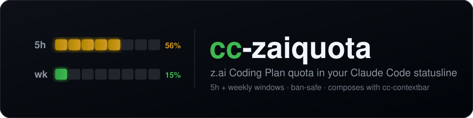
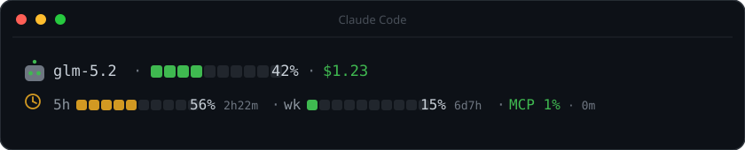

<p align="center">
  
</p>

<p align="center">
  <a href="https://github.com/evggzzz/cc-zaiquota/releases"></a>
  
  
  
  
  
  
</p>

# z.ai の制限、引っかかる前にわかる。

[Claude Code](https://code.claude.com) のステータスラインに常時表示される、z.ai GLM Coding Plan 向けの**クォータメーター**。5時間・週次・MCPの各ウィンドウを、カラーバーとリセットまでのカウントダウン付きで可視化します。

Anthropic 側で使うセッションには **v1.1 から自動切り替え**：`ANTHROPIC_BASE_URL` に z.ai が含まれないセッションは、Claude Code がステータスラインに渡す **claude.ai Pro/Max/Ultra のレート制限（5時間＋週次）** をそのまま表示します。追加リクエストも設定も不要です。

<p align="center">
  <sub><a href="README.md">English</a> · <a href="README.zh-CN.md">简体中文</a> · <a href="README.ja.md">日本語</a></sub>
</p>

<p align="center">
  
</p>

---

## ✨ 機能

| | |
|---|---|
| ⏳ **3つのウィンドウを一目で** | 5時間ローリング・週次（7日）・MCP月次を、それぞれカラーバー＋％＋リセットまでの時間で表示します。 |
| 🔀 **プロバイダ自動切り替え** | z.aiセッションなら z.ai クォータ、Anthropicセッションなら claude.ai のプラン使用率。同じステータスラインで、設定不要。 |
| 🎨 **リッチかつコンパクト** | カラーのバッテリーバー＋太字の％＋薄い色のカウントダウン。デフォルトは2幅emojiなし（ワイド端末なら `ZAI_ICONS=1` で表示）。 |
| 🧩 **cc-contextbar と合成** | [cc-contextbar](https://github.com/evggzzz/cc-contextbar) の下に重ねて2行ステータスラインに。単体でも使えます。 |
| 🛡️ **BAN回避設計** | ステータスラインはキャッシュ読込のみで**描画ごとの通信ゼロ**。更新はオンデマンドで、z.ai公式と**同一のリクエスト**を使います。 |
| ⚡ **AIエージェント不要** | 公式 `glm-plan-usage` プラグインと違い、更新はシェル1呼び出し（ミリ秒、約20秒ではありません）。 |

## 😤 問題

z.ai はウィンドウを使い切った瞬間に制限をかけます。しかも、まったく見えないまま次々に作業してしまう――なぜなら：

- Claude Code の**標準メーターは z.ai だと永遠に `0`** のまま（あのフィールドは Claude.ai 専用）。
- **公式** `glm-plan-usage` プラグインは動くが、確認のたびにAIエージェントを起動して**約20秒**かかる。

**cc-zaiquota は同じデータを一瞬で、常時、BAN安全に表示します。**

## 📊 他との比較

| | 標準 | 公式プラグイン | **cc-zaiquota** |
|---|:--:|:--:|:--:|
| z.aiクォータ表示 | ❌ ずっと `0` | ✅ | ✅ |
| 常時表示 | ❌ | ❌ オンデマンド | ✅ |
| 取得の速さ | — | 約20秒（AI経由） | **ミリ秒（シェル）** |
| 自動更新 | — | ❌ | ✅ |
| BAN安全 | — | ✅ 公式 | ✅ 同一リクエスト |

## 🛡️ BANを回避する仕組み

- ステータスラインは**ネットワーク通信を一切しない**。`~/.claude/zaiquota/quota.cache` を読むだけです。
- `/cc-zaiquota:refresh` は z.ai 公式 `glm-plan-usage` と**同一のリクエスト**（`GET {baseDomain}/api/monitor/usage/quota/limit`、`Authorization: $ANTHROPIC_AUTH_TOKEN`）。エンドポイントもヘッダも同じなので、公式ツールと区別がつきません。
- デフォルトはオンデマンドのみ（ポーリングループなし）。

## ♻️ 自動更新（OSデーモン）

バックグラウンドデーモンが `ZAI_REFRESH_MIN`（デフォルト600秒）ごとにキャッシュを更新します — macOSは**launchd**、Linuxは**cron**。Claude Codeとは独立に動くので、セッションを開いていない時やアイドル中も常に最新が保たれます。

- インストーラがz.aiの認証情報を `~/.claude/zaiquota/config.env`（chmod 600）に書き込みます — launchd/cronはシェルの環境変数を継承しないため、デーモンがAPIに届くために必要です。
- 間隔を調整: `config.env` に `ZAI_REFRESH_MIN=300` を設定して `install.sh` を再実行。
- 即時更新: `/cc-zaiquota:refresh`。
- デーモンのログ: `~/.claude/zaiquota/daemon.log`。

ステータスライン本体は**通信ゼロ**のままです。

## 🔀 z.ai と Anthropic を併用する場合

`claude` ラッパーで z.ai の env を読み込み、`cl` は Anthropic サブスク、
GUI はそのまま、のようにプロバイダをコマンド単位で切り替えている場合も、
インストールは 1 回で済みます。描画のたびに mod が `ANTHROPIC_BASE_URL` を判定します：

- `z.ai` を含む → z.ai GLM Coding Plan のクォータ（ローカルキャッシュから）
- それ以外 → claude.ai の**プラン使用率**（`rate_limits.five_hour` ／
  `rate_limits.seven_day`）。Pro/Max/Ultra のセッションで、Claude Code が
  ステータスラインの標準入力に渡してくれる公式データです（セッションの最初の
  API応答以降に表示されます）

各セッションは自分のプロバイダのクォータだけを表示します。ベースURLを env で
見せたくない構成なら `config.env` に `ZAI_PROVIDER=zai` か
`ZAI_PROVIDER=anthropic` を書いて固定してください。`CLAUDE_CONFIG_DIR` を
分けている場合は、config dir ごとにインストーラを実行すれば、それぞれの
`settings.json` に同じ mirror が配線され、mod は各セッション自身の env を
読んで判定します。

## 🚀 インストール

> 環境変数 `ANTHROPIC_BASE_URL`＋`ANTHROPIC_AUTH_TOKEN`（公式プラグインと同じ）と [`jq`](https://stedolan.github.io/jq/) が必要です。

**A — プラグインで**

```bash
claude plugin marketplace add evggzzz/cc-zaiquota
claude plugin install cc-zaiquota@cc-zaiquota
```

そのあと Claude Code 上で：

```
/cc-zaiquota:refresh
```

**B — 1行で**

```bash
curl -fsSL https://raw.githubusercontent.com/evggzzz/cc-zaiquota/main/scripts/install.sh | bash
```

どちらもスクリプトを `~/.claude/zaiquota/` に置き、`statusLine` を**無言のstdinミラー**（`mirror.sh` — Claude Codeが渡すJSONのrate_limitsをディスクに書くだけで、画面には何も出さない）に向け、**OSの更新デーモン（macOS: launchd／Linux: cron）を導入**します（事前に `.bak` でバックアップ）。z.aiの認証情報は `config.env`（chmod 600）に保存されます。**Claude Code を再起動**してください。

画面への描画は、このプラグインに同梱の **hooks-module mod**（`hooks/register.ts`）が担います。方式A（またはdev modとしてフォルダを読み込み）でmodを有効にすると、プロンプト下にクォータ行をピン留めし、30秒ごとに再描画します。modエンジンのないビルドでは、同梱のbashレンダラ（`quota.sh`／`quota-anthropic.sh`）が代替です：`statusLine` を `mirror.sh` の代わりにどちらかへ向けてください。

## 🔬 仕組み

- `quota-fetch.sh` → `GET /api/monitor/usage/quota/limit` を叩き、`.data`＋タイムスタンプをキャッシュに保存。
- `hooks/register.ts` → mod本体。プロバイダを判定し（上の 🔀 参照）、キャッシュかミラーを読み、`$.ui.status` でプロンプト下に行をピン留め。30秒ごとに再描画してカウントダウンを動かします。
- `mirror.sh` → modモードでの `statusLine` の仕事はこれだけ：stdin JSONの `rate_limits` を `~/.claude/zaiquota/rate_limits.json` に書き、出力はなし。
- `quota.sh` ／ `quota-anthropic.sh` → modエンジンのないビルド向けのbashレンダラ（`statusLine` を `mirror.sh` の代わりにこちらへ向ける）。

## ⚙️ カスタマイズ

`~/.claude/zaiquota/config.env` を作ってデフォルトを上書きできます：

| 変数 | デフォルト | 効果 |
|---|---|---|
| `ZAI_SEGMENTS` | `10` | バーのセル数（両ウィジェット共通） |
| `ZAI_FILL` / `ZAI_EMPTY` | `█` / `░` | バーの文字 |
| `ZAI_ICONS` | `0` | `1` でemojiアイコンを表示（ワイド端末向け） |
| `ZAI_REFRESH_MIN` | `600` | 自動更新の最小間隔（秒） |
| `ZAI_PROVIDER` | auto | `zai` / `anthropic` で2行目を固定（`ANTHROPIC_BASE_URL` 判定の代わり） |

```bash
# ~/.claude/zaiquota/config.env
ZAI_SEGMENTS=8
ZAI_ICONS=1
ZAI_REFRESH_MIN=300
```

## 🗑️ アンインストール

```bash
curl -fsSL https://raw.githubusercontent.com/evggzzz/cc-zaiquota/main/scripts/install.sh | bash -s -- --uninstall
```

`statusLine` を cc-contextbar に戻し（存在すれば）、`~/.claude/zaiquota/` を削除します。

---

> ⭐ **z.ai の制限に作業中を止められたことがある人 ―― これ、あなたのためです。**

## ⭐ Star History

<a href="https://star-history.com/#evggzzz/cc-zaiquota&Date">
  
</a>

## 📄 ライセンス

MIT © [evggzzz](https://github.com/evggzzz)
