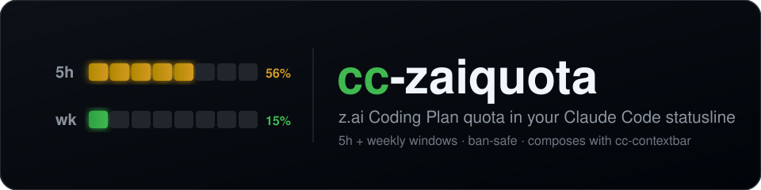
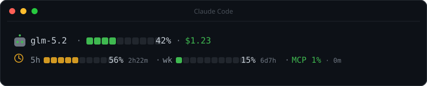

<p align="center">
  
</p>

<p align="center">
  <a href="https://github.com/evggzzz/cc-zaiquota/releases"></a>
  
  
  
  
  
  
</p>

# Know exactly when z.ai will throttle you — before it happens.

A live, battery-style **quota meter for the z.ai GLM Coding Plan**, right in your
[Claude Code](https://code.claude.com) statusline. The 5-hour, weekly, and MCP
windows — each with a color-coded bar and a countdown to reset.

Talking to Anthropic instead? **v1.1 auto-switches**: sessions without z.ai in
`ANTHROPIC_BASE_URL` show the **claude.ai Pro/Max/Ultra rate limits** (5h + weekly)
that Claude Code itself feeds the statusline — no extra requests, no config.

<p align="center">
  <sub><a href="README.md">English</a> · <a href="README.zh-CN.md">简体中文</a> · <a href="README.ja.md">日本語</a></sub>
</p>

<p align="center">
  
</p>

---

## 😤 The problem

z.ai throttles you the moment a window fills — and you're flying blind, because:

- Claude Code's **native meter reports `0` forever** on z.ai (that field is Claude.ai-only).
- The **official** `glm-plan-usage` plugin works, but every check spins up an AI agent that takes **~20 seconds**.

**cc-zaiquota shows the same data — instantly, always-on, and ban-safe.**

## ✨ Features

| | |
|---|---|
| ⏳ **Three windows, one glance** | 5h rolling · weekly · MCP — each a colored bar, a %, and a reset countdown. |
| 🔀 **Auto provider switch** | z.ai session → z.ai quota. Anthropic session → claude.ai plan rate limits. Same statusline, zero config. |
| 🟢🟡🔴 **Color-coded** | Green → yellow → red as you burn a window. **Bold-red when you're about to get throttled.** |
| ⚡ **Instant, not 20 s** | One shell call — not an LLM. Milliseconds. |
| 🛡️ **Ban-safe** | Statusline = zero network. Refresh reuses z.ai's *exact* official request. |
| ♻️ **Auto-refresh (daemon)** | A launchd/cron daemon refreshes every ~10 min — even when Claude Code is closed. |
| 🧩 **Stacks with cc-contextbar** | Two-line statusline next to [cc-contextbar](https://github.com/evggzzz/cc-contextbar). Works standalone too. |

## 📊 How it compares

| | Native | Official plugin | **cc-zaiquota** |
|---|:--:|:--:|:--:|
| Shows z.ai quota | ❌ always `0` | ✅ | ✅ |
| Always-on statusline | ❌ | ❌ on-demand | ✅ |
| Query latency | — | ~20 s (AI agent) | **ms (shell)** |
| Auto-refresh | — | ❌ | ✅ |
| Ban-safe | — | ✅ official | ✅ same request |

## 🛡️ Ban-safe by design

- The statusline reads a local cache — **zero network per render**.
- A refresh sends the **exact** official request (`GET {baseDomain}/api/monitor/usage/quota/limit` with `Authorization: $ANTHROPIC_AUTH_TOKEN`). Same endpoint, same headers → indistinguishable from `glm-plan-usage`.

## 🔀 Running z.ai and Anthropic side by side?

If you switch providers per command — say a `claude` wrapper that exports the
z.ai env and a plain `cl` on your Anthropic subscription — one install covers
both. Every render, the composer checks `ANTHROPIC_BASE_URL`:

- contains `z.ai` → z.ai GLM Coding Plan quota (from the local cache)
- anything else → claude.ai **plan rate limits** (`rate_limits.five_hour` /
  `rate_limits.seven_day`), which Claude Code passes to the statusline on stdin
  for Pro/Max/Ultra sessions — they appear after the first API response

Each session shows its own provider's quota, same bars. Pin it in
`config.env` with `ZAI_PROVIDER=zai` or `ZAI_PROVIDER=anthropic` if your setup
hides the base URL. If you also run separate `CLAUDE_CONFIG_DIR`s, point each
one's `settings.json` `statusLine` at the same composer.

## 🚀 Install

> Requires `ANTHROPIC_BASE_URL` + `ANTHROPIC_AUTH_TOKEN` (same as the official plugin) and [`jq`](https://stedolan.github.io/jq/).

**Option A — as a plugin**

```bash
claude plugin marketplace add evggzzz/cc-zaiquota
claude plugin install cc-zaiquota@cc-zaiquota
```

Then in Claude Code:

```
/cc-zaiquota:refresh
```

**Option B — one-liner**

```bash
curl -fsSL https://raw.githubusercontent.com/evggzzz/cc-zaiquota/main/scripts/install.sh | bash
```

Both drop the scripts under `~/.claude/zaiquota/`, add a composer at `~/.claude/statusline-compose.sh`, point `statusLine` at it, and install an **OS refresh daemon** (launchd on macOS, cron on Linux). Your z.ai credentials are stored in `~/.claude/zaiquota/config.env` (chmod 600) so the daemon can reach the API. A `.bak` backup is written first. **Restart Claude Code**.

## 🔬 How it works

- `quota-fetch.sh` → `GET /api/monitor/usage/quota/limit`, stores `.data` + a timestamp.
- `quota.sh` → parses `data.limits[]`: the two `TOKENS_LIMIT` entries are 5h (sooner `nextResetTime`) and weekly (later); `TIME_LIMIT` is MCP monthly. Countdowns are computed live from each absolute `nextResetTime`.
- `quota-anthropic.sh` → renders `rate_limits.five_hour` / `rate_limits.seven_day` straight from the statusline stdin JSON (no network, nothing cached).
- `compose.sh` → picks the widget by provider (see 🔀 above), runs cc-contextbar (line 1) then it (line 2); set as `statusLine`.

## ⚙️ Customize

`~/.claude/zaiquota/config.env`:

| Var | Default | Effect |
|---|---|---|
| `ZAI_SEGMENTS` | `10` | bar cells (both widgets) |
| `ZAI_FILL` / `ZAI_EMPTY` | `█` / `░` | bar glyphs |
| `ZAI_ICONS` | `0` | `1` = emoji icons (wide terminals) |
| `ZAI_REFRESH_MIN` | `600` | auto-refresh min interval (s) |
| `ZAI_PROVIDER` | auto | `zai` / `anthropic` to pin line 2 instead of `ANTHROPIC_BASE_URL` sniffing |

## 🗑️ Uninstall

```bash
curl -fsSL https://raw.githubusercontent.com/evggzzz/cc-zaiquota/main/scripts/install.sh | bash -s -- --uninstall
```

Reverts `statusLine` to cc-contextbar and stops/removes the daemon + `~/.claude/zaiquota/`.

---

> ⭐ **If z.ai has ever throttled you mid-flow — this is for you.**

## ⭐ Star History

<a href="https://star-history.com/#evggzzz/cc-zaiquota&Date">
  
</a>

## 📄 License

MIT © [evggzzz](https://github.com/evggzzz)
